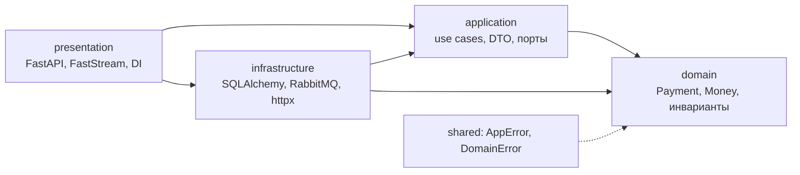
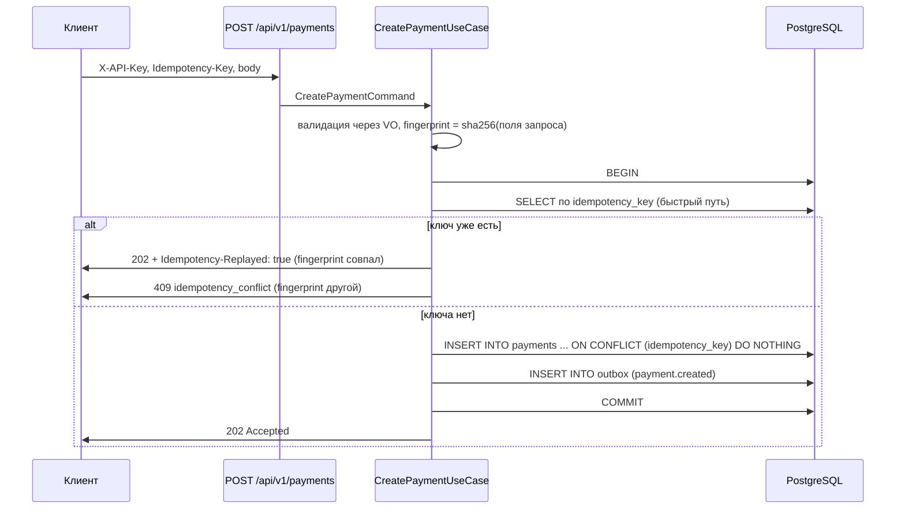
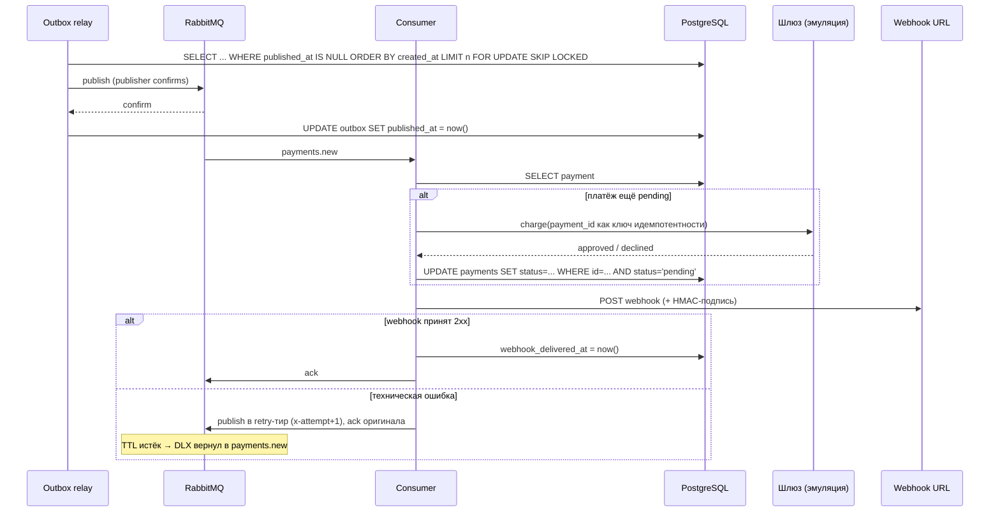

# Архитектура сервиса

Документ для того, кто читает код впервые: какие слои есть, что куда класть, как
проходит платёж и где проходят транзакционные границы. Требования —
[0001-async-payment-processing.md](briefs/0001-async-payment-processing.md).

## 1. Слои и направление зависимостей

```
presentation ──► application ──► domain
      │                ▲
      └──► infrastructure ┘        (infrastructure реализует порты application)
```



Правило проверяется машинно, а не на словах:

```bash
uv run lint-imports     # 4 контракта: слои, domain без фреймворков, application без инфраструктуры, shared без payments
```

| Слой | Каталог | Что здесь живёт | Чего здесь быть не может |
|------|---------|-----------------|--------------------------|
| Domain | `src/payments/domain/` | `Payment`, `OutboxEvent`, `Money`, `IdempotencyKey`, `WebhookTarget`, `PaymentOutcome`, enum'ы, доменные исключения, `build_request_fingerprint` | импорты SQLAlchemy, FastAPI, FastStream, pydantic, httpx, dishka |
| Application | `src/payments/application/` | пять use case'ов, DTO (`dto/`), порты (`ports/`) | знание про БД, брокер, HTTP; вызовы внешних сервисов напрямую |
| Infrastructure | `src/payments/infrastructure/` | ORM-модели и мапперы, репозитории, UoW, `config.py`, эмулятор шлюза, FastStream-обвязка, httpx-сендер webhook'ов, clock/id-генератор | бизнес-решения; HTTP-статусы |
| Presentation | `src/payments/presentation/` | FastAPI-приложение, роутеры, Pydantic-схемы, DI-провайдеры, exception handlers, FastStream subscriber | бизнес-логика, SQL-запросы, прямые обращения к брокеру |
| Shared kernel | `src/shared/exceptions/` | `AppError` → `DomainError` → `InfraError` | импорт `payments` |

## 2. Куда класть логику

| Что нужно сделать | Куда | Пример в коде |
|---|---|---|
| Новое правило о платеже (переход статуса, инвариант суммы) | `domain/entities.py`, `domain/value_objects.py` | `Payment.mark_failed`, `Money.__post_init__` |
| Новый сценарий («создать платёж», «отправить webhook») | `application/use_cases/` | `CreatePaymentUseCase.execute` |
| Обратиться к БД, брокеру, внешнему API | `infrastructure/` за портом из `application/ports/` | `SqlAlchemyPaymentRepository`, `HttpWebhookSender` |
| Новый HTTP-эндпоинт | `presentation/api/routers/` + схема в `schemas.py` | `create_payment` |
| Маппинг доменной ошибки в HTTP | `presentation/api/errors.py` | `DOMAIN_CODE_TO_HTTP` |
| Политика ack/nack/retry сообщения | `infrastructure/messaging/consumer.py` (транспортный слой), вызов — `presentation/consumer_entrypoint.py` | `_retry`, `_park` |
| Настройка окружения | `infrastructure/config.py` | `Settings` |

Правило простое: **решение** — в domain/application, **доступ к внешнему миру** — в
infrastructure за портом, **перевод в транспорт** — в presentation.

## 3. Создание платежа



Обе вставки — **одна транзакция**. Именно поэтому невозможна ситуация «платёж есть,
события нет» и наоборот. В API нет публикации в брокер: сеть не участвует в
транзакции.

## 4. Обработка платежа



Два свойства, которые дают гарантии:

- **at-least-once**: relay может опубликовать событие повторно (упал между
  публикацией и `COMMIT`), брокер может доставить сообщение дважды;
- **идемпотентность**: `UPDATE ... WHERE status='pending'` при повторной доставке
  не меняет ничего, `webhook_delivered_at IS NULL` не даёт отправить webhook второй
  раз. Итог — эффект ровно один раз при любом числе доставок.

Порядок сообщений не гарантируется и не нужен: платежи не зависят друг от друга.

## 5. Ретраи и DLQ

| Обработка | Куда уходит сообщение после отказа | Задержка перед возвратом |
|---|------------------------------------|--------------------------|
| 1 | `payments.retry.1` | 5 с |
| 2 | `payments.retry.2` | 25 с |
| 3 | `payments.dlq` | — |

Число тиров выводится из `RETRY_DELAYS_MS`: N задержек — N повторов и N+1
обработок. Задержка — очередь с `x-message-ttl` и DLX обратно в
`payments`/`payments.new`, а не `sleep` в обработчике: обработчик не держит слот и
не рвёт heartbeat. Тиры вместо одной очереди с per-message TTL — потому что
RabbitMQ смотрит TTL только у головы очереди (head-of-line blocking).

Попытка считается в собственном заголовке `x-attempt` (0-based): он переносится
между тирами вместе с сообщением. `x-death` брокера не используется — его
содержимое зависит от топологии, а политика должна быть воспроизводимой в тестах.
`requeue=True` не используется нигде: это бесконечный цикл на poison-сообщении.
Аргументы очереди неизменяемы, поэтому смена `RETRY_DELAYS_MS` требует
пересоздания очередей (иначе consumer падает на объявлении топологии — это видно
по healthcheck'у).

Публикация идёт с `mandatory=True` и `on_return_raises=True`: сообщение, которому
не нашлось очереди, не считается опубликованным и остаётся в outbox.

Что ретраится и что нет:

| Событие | Действие |
|---|---|
| Отказ шлюза (`declined`) | `status=failed` + webhook, **без** ретрая — это бизнес-результат |
| Таймаут/недоступность шлюза | `PaymentProcessingError` → retry-тир, статус остаётся `pending` |
| Webhook не принят / таймаут | `WebhookDeliveryError` → retry-тир |
| Битый payload, неизвестный платёж | сразу `payments.dlq`, лимит попыток не тратится |
| Брокер недоступен при публикации из outbox | Публикация ограничена таймаутом 5 с, событие остаётся неопубликованным, попытки **не расходуются**, пачка прерывается до следующего тика |
| Payload события не сериализуется | `EventPayloadInvalidError` — единственная постоянная ошибка публикации, считается в `attempts` и приводит к парковке |

## 6. Ошибки

```
AppError (code, message, details)
├── DomainError
│   └── PaymentsDomainError
│       ├── PaymentNotFoundError        payment_not_found          → 404
│       ├── IdempotencyConflictError    idempotency_conflict       → 409
│       ├── InvalidAmountError          invalid_amount             → 422
│       ├── InvalidWebhookTargetError   invalid_webhook_url        → 422
│       ├── InvalidIdempotencyKeyError  invalid_idempotency_key    → 422
│       ├── PaymentNotFinalizedError    payment_not_finalized      → 409
│       ├── PaymentProcessingError      payment_processing_failed  → 503 / retry
│       └── WebhookDeliveryError        webhook_delivery_failed    → retry/DLQ
└── InfraError                          infra_error                → 503
```

Vendor-исключения переводятся в доменные **в адаптере** (`IntegrityError` →
`InvalidAmountError`/`InfraError`, `httpx.*` → `WebhookDeliveryError`), с сохранением
цепочки `raise ... from exc`. HTTP отдаёт `ErrorEnvelope {code, message, details}`;
`details` — явный whitelist полей, без стеков и SQL.

## 7. Точки входа

| Процесс | Команда | Что делает |
|---|---|---|
| API | `uvicorn --factory payments.presentation.api.app:create_app` | два эндпоинта, `/health`, `/ready`, встроенный outbox relay |
| Consumer | `python -m payments.presentation.consumer_entrypoint` | слушает `payments.new`, обрабатывает платёж и webhook |
| Relay (standalone) | `python -m payments.infrastructure.messaging.outbox_relay` | публикация outbox, когда API вынесен отдельно |
| Миграции | `alembic upgrade head` | схема БД |

Relay по умолчанию живёт фоновой задачей в процессе API (чтобы `docker compose`
оставался из четырёх сервисов, как в ТЗ); он же запускается отдельным процессом —
`SKIP LOCKED` делает параллельные relay безопасными.

## 8. Тесты

| Уровень | Каталог | Что проверяет | Окружение |
|---|---|---|---|
| Unit | `tests/unit/` | домен, use case'ы на фейковых портах, маппинг ошибок | без сети и БД |
| Integration | `tests/integration/` | репозитории и `SKIP LOCKED` на живом PostgreSQL, HTTP-контракты, e2e с RabbitMQ и webhook-sink | testcontainers + Docker |

## 9. Путь масштабирования

Что меняется при росте нагрузки (подробнее — в README):

1. больше слотов обработки: `prefetch` и конкурентность consumer'а, несколько реплик
   — безопасно, потому что переходы статусов guarded;
2. webhook выносится в отдельную очередь, чтобы медленный клиент не занимал слот
   обработки платежа;
3. relay: `FOR UPDATE SKIP LOCKED` и батчи уже есть; при десятках тысяч событий в
   секунду polling заменяется на `LISTEN/NOTIFY` или CDC;
4. PostgreSQL: партиционирование `payments` по `created_at`, PgBouncer, короткие
   транзакции;
5. API stateless и масштабируется горизонтально; ограничение — уникальный индекс
   `idempotency_key`, который остаётся корректным при любом числе реплик.
